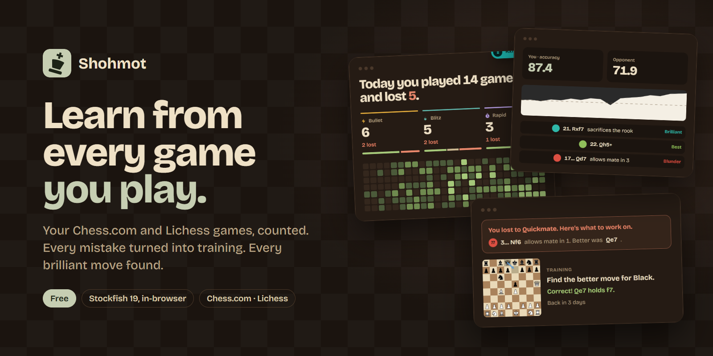
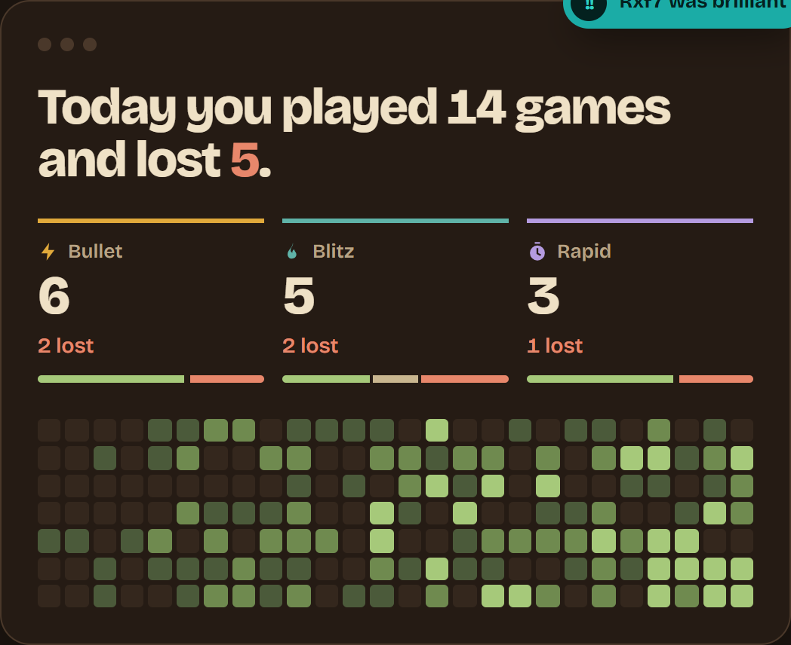
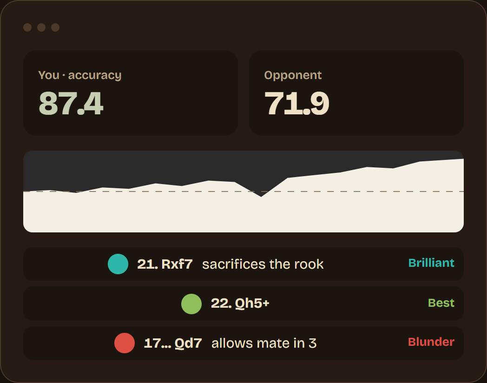
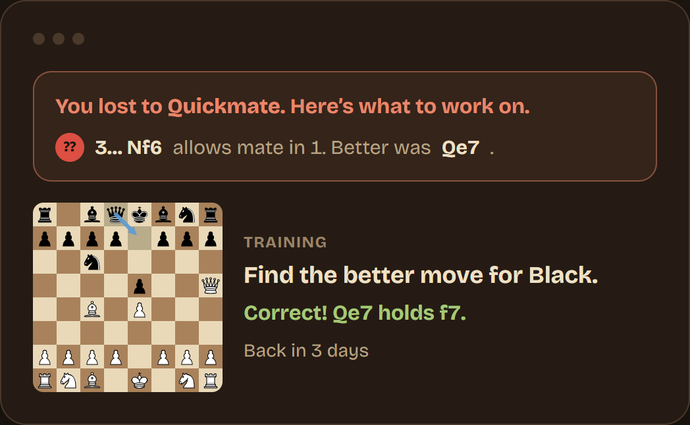
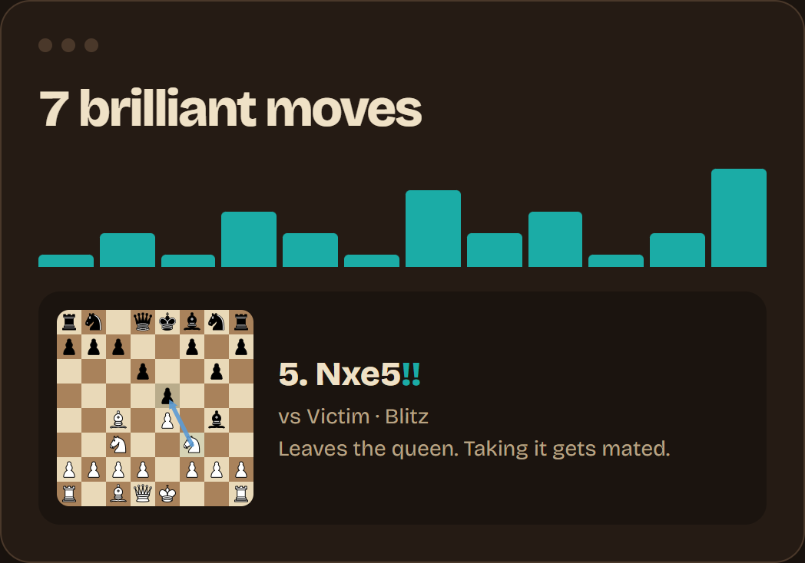
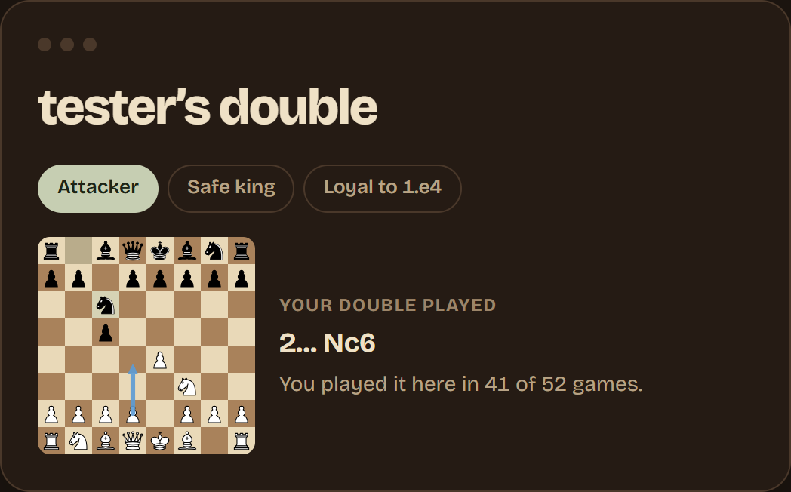
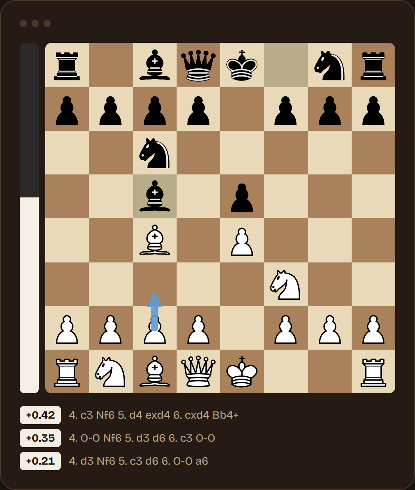
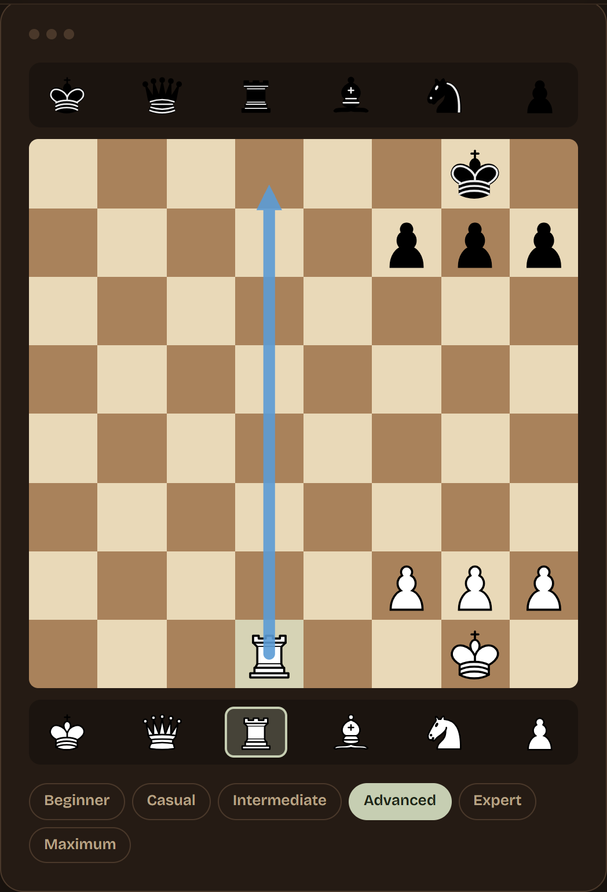
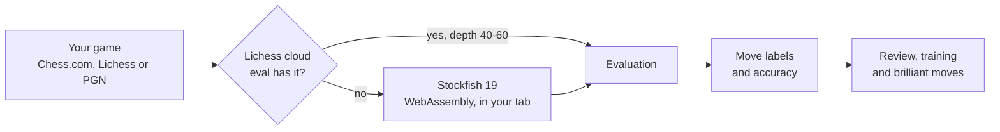

<div align="center">



<br><br>

**Every game counted. Every mistake trained. Every brilliant move found.**

Shohmot follows your [Chess.com](https://www.chess.com) and [Lichess](https://lichess.org) accounts, tells you how many games you played today and how many you lost, then lets Stockfish turn your mistakes into training. All of the engine work happens in your browser.

<br>


[Quick start](#-quick-start) · [Features](#-features) · [How it works](#-how-the-review-works) · [Deploy](#-deploy) · [Docs](docs/DETAILS.md)

</div>

<br>

## ✨ Why Shohmot

You play dozens of games a week and remember almost none of them. Shohmot keeps the score for you, and then does the part chess sites tend to bury behind a paywall: it shows what you got wrong and makes you practice it.

<table>
<tr>
<td width="33%" valign="top">

### 📊 Know the score
Played and lost, per game type, per account. Bullet, blitz, rapid and daily, refreshed every minute, with a 26-week calendar.

</td>
<td width="33%" valign="top">

### 🧠 Fix the cause
Stockfish checks every game as it ends and turns each blunder into a position you train, spaced so it sticks.

</td>
<td width="33%" valign="top">

### 💎 Find the magic
Scans every game you've played for sound piece sacrifices and marks them as brilliant moves.

</td>
</tr>
</table>

<br>

## 🎯 Features

Seven tools, one app. Five of them work without an account.

### Game counter



How many games you played today and how many you lost, for every type of game on every account (up to four, Chess.com and Lichess mixed). Step back a day with the arrows, or click any day in the calendar to see up to 26 weeks of history. Rated only, or everything, your call.

<br clear="right">

### Game review



Paste a Lichess link or any PGN and get a full Stockfish 19 review: accuracy for both players, an evaluation graph, a label on every move (Brilliant, Great, Best, Excellent, Good, Book, Forced, Inaccuracy, Mistake, Miss, Blunder), the better move as an arrow, and a plain reason why yours wasn't it. Pasted games never leave your browser.

**No account needed.**

<br clear="left">

### Mistake training



After every game Shohmot says "You lost to X, here's what to work on" and lists your worst moves. Every mistake becomes a position to solve, scheduled with spaced repetition (1, 3, 7 and 21 days), so you meet it again just before you'd forget it.

<br clear="right">

### Brilliant moves



A cheap scan finds the games where you sacrificed a piece, and Stockfish verifies only those. Following Chess.com's published description, a brilliant move is a sound sacrifice that is the best or nearly the best move, leaves you no worse, and wasn't needed because you were winning anyway.

<br clear="left">

### Play yourself



Type any username and Shohmot builds a **double**: a bot that plays that player's own openings, at their rating, with their style (attacker, safe king, loyal to 1.e4). Play it, then send a friend a link to play it too. **No account needed.**

<br clear="right">

### Analysis board



A free board with a live engine: the top three lines, the best move as an arrow, variations nested as deep as you like, and a position editor to set up any position and ask Stockfish about it. **No account needed.**

<br clear="left">

### Set up and play



Set up any position and play it out against Stockfish at six strengths, from Beginner to Maximum. Good for practicing the endgame you keep botching. **No account needed.**

<br clear="right">

## 🎓 Meet Fischer, your coach


Fischer sits at the top of every review. It breathes, blinks, moves its mouth in time with its voice, and reacts to your moves: a nod for good ones, a hop for great ones, a shake for mistakes. It walks you through the key moments of the game and gives you a short lesson for each kind of mistake.

Set `ANTHROPIC_API_KEY` and Fischer becomes an AI agent powered by Claude. It leads the review moment by moment, moves the board itself, and answers your questions about the game. It is grounded in Stockfish's numbers and told not to invent analysis. Without a key, Fischer still steps through the game using the review's own notes. Its voice is off until you turn it on.

<br clear="left">

## 🚀 Quick start

You need Node 22.23 or newer.

```bash
npm install
npm run dev
```

Open <http://localhost:4321>. That's Astro's dev server with live reload, and it answers `/api/*` with the same handlers Vercel runs. Accounts are kept in `data/store.json`, which is gitignored.

To run it the way production does (a built site plus the API on one port):

```bash
npm start
```

Then open <http://localhost:3001>. To run the tests:

```bash
npm test
```

## 🔬 How the review works

Reviews run on your machine, so the server does no engine work and your games stay private.



1. **Lichess cloud evals first.** Positions Lichess has already searched deeply are fetched, which covers most openings.
2. **Stockfish 19 for the rest.** The full network runs on up to three cores on desktop; a lighter one is used on phones.
3. **Backward analysis.** The game is split into stretches and each engine works from the last position to the first, so every move is judged knowing what it led to.

Lichess accuracy uses Lichess's own published formula, and it lands within about 3 points of Lichess's number on average. Chess.com's formula is private, so Chess.com games use a fit against games Chess.com had also reviewed. The details and the tuning notes are in [docs/DETAILS.md](docs/DETAILS.md#game-review).

## 🧱 Built with

| | |
|---|---|
| **[Astro](https://astro.build)** | The site. The landing page's boards and calendars are drawn at build time, so the public pages ship about 1 KB of script. |
| **Plain Node functions** | The API, with no framework (`api/`, code in `src/`). |
| **[Stockfish 19](https://stockfishchess.org)** | The engine, as WebAssembly, in the browser. |
| **[chess.js](https://github.com/jhlywa/chess.js)** | Move generation and replay. |
| **Upstash Redis** or a JSON file | Accounts, on Vercel or locally. |
| **Claude** (optional) | Fischer, the AI coach. |

Built to feel instant: pages are prefetched and cross-fade with View Transitions, the counter opens complete from a local copy and then syncs only what's new, and every page passes axe-core's WCAG 2.2 AA rules on desktop and mobile.

## 🌍 Deploy

Vercel runs `astro build`, serves `dist/`, and runs the files in `api/` as functions.

1. Import the repo in Vercel, or run `npx vercel --prod`.
2. Make a free Redis database at [console.upstash.com](https://console.upstash.com) and add its REST URL and token as `UPSTASH_REDIS_REST_URL` and `UPSTASH_REDIS_REST_TOKEN`.
3. Redeploy, then open `/api/health` to check what it found.

[`.env.example`](.env.example) lists every setting, and [`LAUNCH.md`](LAUNCH.md) is the full go-live checklist.

Everything is free for everyone until Stripe is configured; setting `STRIPE_SECRET_KEY` and `STRIPE_PRICE_PRO` switches plans on without a code change.

## 📚 Documentation

| | |
|---|---|
| [docs/DETAILS.md](docs/DETAILS.md) | Every feature in depth, accounts and security, plans, the API |
| [LAUNCH.md](LAUNCH.md) | Checklist for putting Shohmot live |
| [.env.example](.env.example) | Every setting |

## 🙏 Credits and licences

Shohmot is not affiliated with Chess.com or Lichess. Opening names come from Lichess's [chess-openings](https://github.com/lichess-org/chess-openings) list (CC0). Stockfish is GPL-licensed; the full list of third-party licences is on the site's `/licenses.html` page.

<div align="center">

<br>


Made for people who lose a bullet game and say "one more."

</div>
